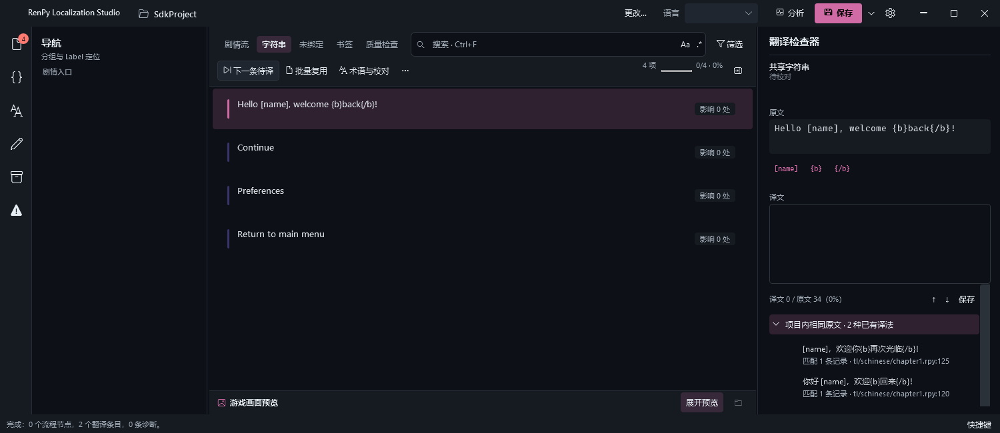
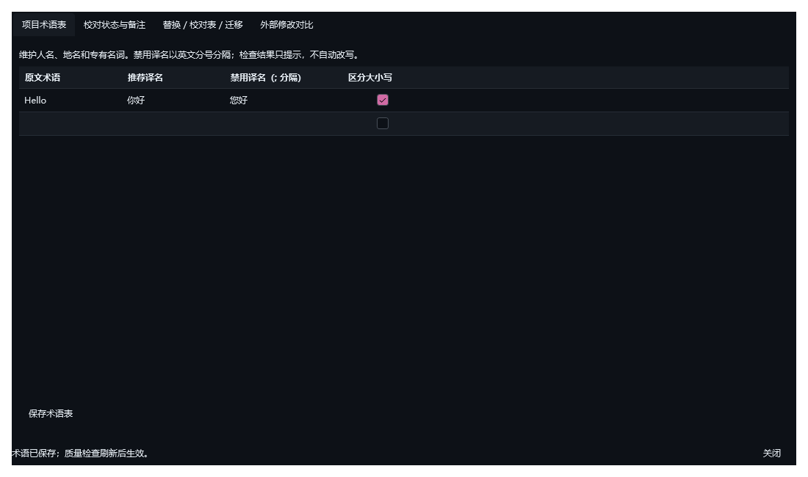

# UI 方案实施与验收（2026-10-22）

基线为 `8b9ada0`。本轮按用户确认完成 A、B、C 三阶段，发布版本 `0.4.0`。报告中标为可选的浅色主题与预览移到检查器未纳入本轮。

## 已完成

- A：修复空列表重复按钮；重组设置与保存菜单，任务取消按需显示；新增边框、文本层级、焦点、语义软背景和字号令牌；统一 CheckBox、Expander、DataGrid、下拉弹窗与带框输入框；主按钮文字按亮度调整；子窗口共用标题栏处理。
- B：顶栏两行化，筛选集中到弹出层，宽屏视图分段选择与窄屏下拉共享名称模板；侧栏只保留分组与导航；替换、回填、迁移、外部对比等进入更多菜单；状态消息统一为按需提示条。检查器限制原文高度，优先保留译文空间，增加字数与导航保存操作，空影响/校验信息折叠。列表使用语义状态胶囊、说话人标记与清晰选中线，状态栏提供快捷键菜单。
- C：导航与检查器使用有宽度约束的 GridSplitter，首选宽度与预览比例/折叠状态持久保存；旧设置缺少新字段时采用默认值，非法数值归一化。首次默认折叠预览。适配系统高对比度，关闭系统动画时跳过自定义过渡。

## 构建与回归

- Release 构建：0 警告、0 错误；单元与集成测试 195 项通过。
- 新增回归覆盖八个强调色和自定义颜色网格的文字对比度、极端栏宽、非法设置、重启恢复、筛选徽标默认值及通知、编辑/保存脏状态提示。
- `scripts/UiProbe` 在实际 WPF STA 线程中创建窗口与控件，覆盖 720 / 900 / 1180 / 1500 / 1920 宽度、四个工具页、GridSplitter 的真实拖动事件、预览收起展开、校对状态、术语保存、批量操作与撤销、Ctrl+F / Ctrl+S / F8 及编辑器占位符。此探针已接入 Windows CI。
- 对八个强调色逐一渲染并断言保存按钮内容实际采用对比前景；对术语表勾选列断言展示样式不再回落到系统模板。
- 格式检查、UTF-8/BOM 保持、工具运行时清单及发布包由本地和 CI 分别验证。

截图使用 WPF 离屏控件渲染与相同字体、夹具，不是桌面硬件截图；未切换用户的系统高对比度设置，不能视为所有 DPI 与系统设置的视觉验收。1500 宽度下两行工具栏始终显示；窄屏将文字缩为带可访问名称的图标，并保留视图下拉与搜索。

## 截图对比

| 宽度 | 改动前 | 改动后 |
| --- | --- | --- |
| 720 | [查看](images/ui-20261022/before-720.png) | [查看](images/ui-20261022/after-720.png) |
| 900 | [查看](images/ui-20261022/before-900.png) | [查看](images/ui-20261022/after-900.png) |
| 1180 | [查看](images/ui-20261022/before-1180.png) | [查看](images/ui-20261022/after-1180.png) |
| 1500 | [查看](images/ui-20261022/before-1500.png) | [查看](images/ui-20261022/after-1500.png) |





## 复现

```powershell
dotnet test RenPyLocalizationStudio.sln -c Release
dotnet run --project scripts/UiProbe -c Release -- artifacts/ui-verification
```

`UiProbe` 只使用模拟分析/保存服务，将设置和 PNG 写入指定产物目录，不读写真实游戏项目。布局恢复的磁盘往返另由临时项目测试覆盖。
